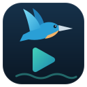

<p align="center"></p>

# Halcyon

YouTube channels, playlists and lives in [Nightglass](https://github.com/MarcDownHQ/nightglass), fully native.

**Status: not usable yet.** The plugin builds and loads, but every catalog and playback call answers "not
implemented yet". The first playable version is milestone M1 in [ROADMAP.md](ROADMAP.md).

Halcyon is a Nightglass plugin: a WebAssembly component that turns the YouTube channels and playlists you list into
series, their current lives into channels, and single videos into movies. It talks to YouTube itself, with no yt-dlp,
no JavaScript runtime outside the plugin and no token server. It is not affiliated with, endorsed by or sponsored by
YouTube or Google.

## Planned usage

Add a source of type Halcyon and fill in at least one of `channels`, `playlists`, `live` or `videos`. Lists are free
text, one entry per line (commas and spaces work too).

| Field | What goes in it |
| --- | --- |
| `channels` | Channels as `@handle`, `https://www.youtube.com/@handle`, `/channel/UC…`, `/c/<name>`, `/user/<name>` or a bare `UC…` id. Each becomes a series of its uploads. |
| `playlists` | Playlist URLs (`…/playlist?list=<id>`) or bare ids. Each becomes a series. |
| `live` | Channels or watch URLs to show as live TV channels. |
| `videos` | Watch URLs or ids, shown as movies. |
| `tabs` | Which uploads go into a channel's series: any of `videos`, `streams`, `shorts`. Default `videos streams`. |
| `max-episodes` | Episodes per series, default `100`. |
| `quality` | The tallest video to play, for example `1080`. Empty means the best. |
| `sign-in` | Empty for anonymous use; `tv` starts a TV sign-in with a code (planned for M6). |
| `account` | The brand account to act as once signed in, by name or handle. |
| `cookies` | A browser `Cookie` header, as an alternative to `tv` sign-in. Accounts that send automated traffic can be banned. |

## Install

Once released, download `halcyon.wasm` from the latest
[GitHub release](https://github.com/MarcDownHQ/Halcyon/releases) into Nightglass's plugin folder:

- Windows: `%APPDATA%\com.marcdownhq.nightglass\plugins`
- macOS: `~/Library/Application Support/com.marcdownhq.nightglass/plugins`
- Linux: `~/.local/share/com.marcdownhq.nightglass/plugins`

Restart Nightglass, then add a source of type Halcyon.

## How it works

The catalog keeps only video ids. Every address is found when you press play, because YouTube's media URLs are signed,
bound to your IP and expire after about six hours.

- **Clients.** Halcyon asks YouTube's player API as the `visionos` client first, which hands out ready, signed media
  URLs with no JavaScript challenge and no PO token, up to 2160p60 with every audio language. `ios_producer` (H.264
  and AAC up to 1080p) is the fallback. Clients that need YouTube's player script come later, with a solver that runs
  inside the plugin.
- **Tracks.** The player gets the best video-only stream under your `quality` cap as its main address, and the audio
  languages (original first, then dubs) and subtitles as separate tracks, which mpv plays together.
- **Lives** play from their HLS manifest.

Details live in [brain/](brain/BRAIN.md). Everything Halcyon knows about YouTube comes from a clean-room
specification and from observing YouTube itself.

## Development

```bash
cargo fmt --check
cargo clippy --all-targets -- -D warnings
cargo clippy --target wasm32-wasip2 --release -- -D warnings
cargo test
scripts/coverage.sh --check                       # 98% of lines
cargo build --release --target wasm32-wasip2       # target/wasm32-wasip2/release/halcyon.wasm
```

The toolchain (Rust with the `wasm32-wasip2` target) is pinned in `rust-toolchain.toml` and `.mise.toml`.

## Licence

MIT, see [LICENSE](LICENSE). `wit/provider.wit` comes from Nightglass, MIT as well. YouTube is a trademark of Google
LLC; Halcyon is an independent project.
